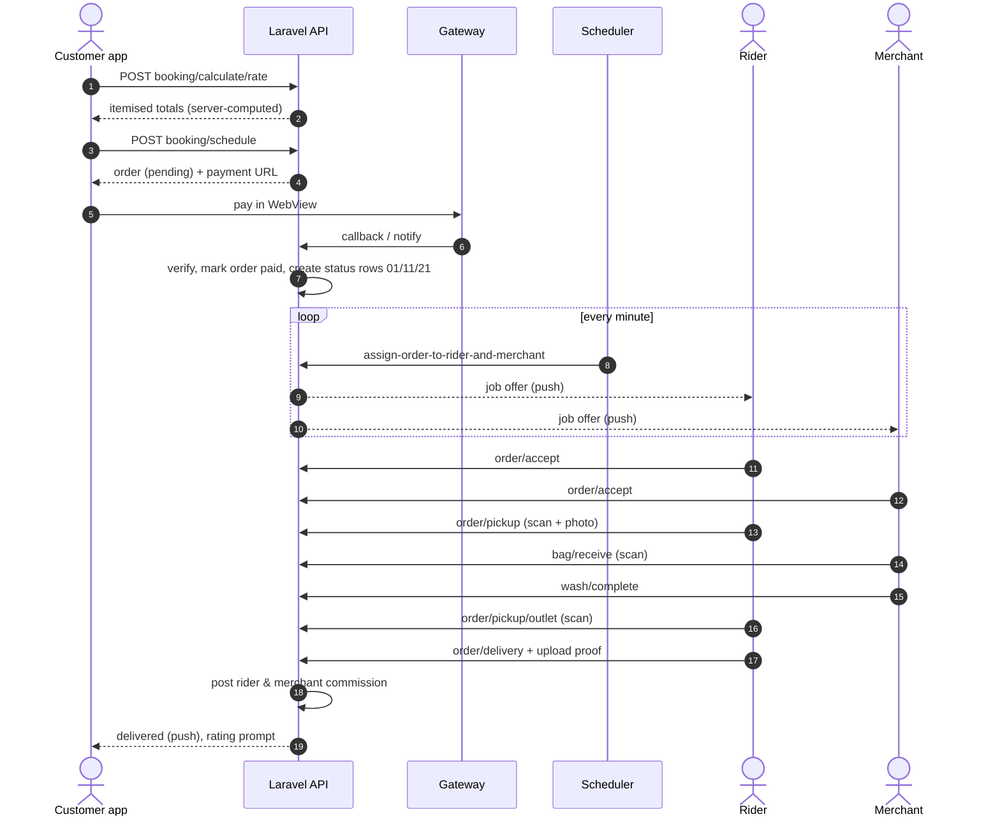

# AutoMaid — System Analysis & Design

> Laundry pickup-and-delivery platform operated under the **LaundryBar / LB Unlimited Wash** brand.
> This document describes what the system does, how it is structured, and the rules it enforces.
> It reflects the codebase as of **October 2026**.

---

## Contents

1. [Overview](#1-overview)
2. [Actors](#2-actors)
3. [Architecture](#3-architecture)
4. [Technology stack](#4-technology-stack)
5. [Codebases & structure](#5-codebases--structure)
6. [Functional requirements](#6-functional-requirements)
7. [Domain model](#7-domain-model)
8. [Order lifecycle](#8-order-lifecycle)
9. [Job assignment engine](#9-job-assignment-engine)
10. [Pricing rules](#10-pricing-rules)
11. [Subscriptions](#11-subscriptions)
12. [Payments](#12-payments)
13. [Commission & settlement](#13-commission--settlement)
14. [Notifications](#14-notifications)
15. [File storage](#15-file-storage)
16. [Admin panel](#16-admin-panel)
17. [Scheduled jobs & artisan commands](#17-scheduled-jobs--artisan-commands)
18. [API design](#18-api-design)
19. [Security](#19-security)
20. [Deployment & operations](#20-deployment--operations)
21. [Constraints, known limits & roadmap](#21-constraints-known-limits--roadmap)

---

## 1. Overview

AutoMaid lets a customer book a laundry pickup from an app. A **rider** collects the customer's tagged bag, takes it to a partner **merchant** (laundry outlet) to be washed, then brings it back. Customers pay per order or subscribe to a monthly plan that includes free bag washes and dry-cleaning discounts.

| Item | Value |
|---|---|
| Backend / admin | `https://app.automaid.asia` (Laravel 11 + Filament v3) |
| Customer app | Flutter — Play Store `paynwash.automaid.customer` |
| Merchant & rider app | Flutter, one app with two roles — Play Store `paynwash.automaid.merchantrider` |
| Marketing site | `https://lbunlimitedwash.com` (static, links to the apps) |
| Service operator | City Coin Laundry Sdn Bhd |
| Payment processing provider | Paynwash Solutions Sdn Bhd |

**Services offered**

- **Wash & fold** — priced per bag (wash fee + delivery fee), with add-ons and vouchers.
- **Dry cleaning** — a parallel service category priced per item, with tier discounts for subscribers.
- **Bag purchase** — customers buy QR-coded laundry bags that identify their order through the whole flow.
- **Subscriptions** — Bronze / Silver / Platinum monthly plans.

---

## 2. Actors

| Actor | Channel | Main goals |
|---|---|---|
| **Customer** | Customer app | Register, buy bags, book pickups, pay, track orders, subscribe, raise support tickets |
| **Rider** | Merchant & rider app (rider role) | Go on duty, accept jobs, pick up from the customer, deliver to the outlet, collect washed bags, deliver back, upload proof photos, view settlements |
| **Merchant** | Merchant & rider app (merchant role) | Go on duty, accept jobs, receive bags, mark the wash complete, view settlements |
| **Admin / operator** | Filament admin panel | Configure prices and coverage, approve riders and merchants, monitor and reassign orders, manage subscriptions, settle commission, run reports |
| **Payment gateways** | Server-to-server callbacks | Confirm payments and recurring charges |
| **Scheduler** | Cron (`schedule:run`) | Auto-assign jobs, renew subscriptions, clean up abandoned checkouts |

---

## 3. Architecture

```mermaid
flowchart LR
    subgraph Clients
        CA[Customer app<br/>Flutter]
        MRA[Merchant & rider app<br/>Flutter]
        ADM[Admin browser<br/>Filament]
        WEB[lbunlimitedwash.com<br/>static site]
    end

    subgraph Cloudflare
        CF[CDN / WAF]
    end

    subgraph Server["Ubuntu server — /srv/www/html"]
        NGX[Nginx + PHP 8.5-FPM]
        API[Laravel 11<br/>REST API /api/*]
        FIL[Filament v3 admin /admin]
        WH[Webhooks /webhook/*]
        SCH[Scheduler<br/>cron every minute]
        DB[(MySQL)]
        CACHE[(Cache / locks)]
    end

    subgraph External
        S3[(AWS S3<br/>Block Public Access)]
        OS[OneSignal<br/>push + email]
        SMS[OneWaySMS<br/>OTP]
        TG[Telegram<br/>admin alerts]
        FIUU[Fiuu]
        GK[GKash]
        RM[Revenue Monster]
        GMAP[Google Maps / Places]
    end

    CA & MRA -->|HTTPS + Sanctum token| CF --> NGX
    ADM --> CF
    NGX --> API & FIL & WH
    API & FIL & WH & SCH --> DB
    API & WH --> CACHE
    API & FIL -->|proxied reads/writes| S3
    API & SCH --> OS
    API --> SMS
    API & WH & SCH --> TG
    API -->|checkout / token charge| FIUU & GK & RM
    FIUU & GK & RM -->|return / notify| WH
    CA & MRA --> GMAP
```



**Design principles in effect**

- **One backend, three front ends.** All business rules live in Laravel; the apps render server-computed totals and never trust their own arithmetic.
- **Synchronous side effects.** No queue worker runs, so notification classes are synchronous (no `ShouldQueue`).
- **Private storage.** S3 is never public. Every image or document is streamed through a Laravel route keyed by an unguessable hashslug.
- **Settings-driven.** Prices, quotas, commission rates, gateway choice, SST and service charges come from one `settings` row that admins edit in Filament.
- **Server-side payment verification.** An order is marked paid only after the gateway confirms it, either by a signed callback or by the backend querying the gateway API. It is completed at most once (cache lock + "already paid" check).

---

## 4. Technology stack

| Layer | Technology |
|---|---|
| Backend framework | Laravel 11 (PHP 8.5) |
| Admin UI | Filament v3.3 (Livewire) |
| Auth | Laravel Sanctum bearer tokens; Spatie Permission roles (`customer`, `rider`, `merchant`, `admin`) |
| Auditing | owen-it/laravel-auditing (model change history) |
| Impersonation | lab404/laravel-impersonate (admin "log in as") |
| IDs in URLs | Sqids hashslugs |
| Database | MySQL |
| Files | AWS S3 via Flysystem, proxied |
| Push / email | OneSignal |
| SMS OTP | OneWaySMS |
| Ops alerts | Telegram bot |
| Payment gateways | Fiuu, GKash, Revenue Monster |
| Mobile | Flutter (Dart ≥ 3.3), Riverpod, GoRouter, Dio, flutter_secure_storage |
| Mobile libraries | mobile_scanner (QR), qr_flutter, image_picker, google_maps_flutter, geolocator, webview_flutter (payment), onesignal_flutter, firebase_core, pdf/printing (receipts), google_fonts |
| Edge | Cloudflare (CDN/WAF) |

---

## 5. Codebases & structure

### 5.1 Backend (`automaid-web`, deployed at `/srv/www/html`)

```
app/
├── Console/Commands/          scheduled jobs + diagnostic/test commands
├── Filament/
│   ├── Resources/             admin CRUD (Orders, Users, Subscriptions, Transactions, …)
│   ├── Widgets/               dashboard stats & charts
│   └── Filters/DateRangeFilter.php
├── Http/Controllers/
│   ├── Api/                   shared auth/profile/location endpoints
│   │   ├── Customer/          customer app endpoints
│   │   ├── Rider/             rider endpoints
│   │   └── Merchant/          merchant endpoints
│   ├── Webhook/               Fiuu, GKash, Revenue Monster callbacks
│   ├── Payment/               hosted card page, saved-card plan-change charge
│   ├── Admin/                 receipt view, terms upload
│   └── PublicDocumentController.php   S3 proxy
├── Models/                    ~65 Eloquent models
├── Notifications/             OneSignal / mail notifications
├── Services/
│   ├── PaymentGateway/        Fiuu, GKash, RevenueMonster clients
│   ├── SubscriptionRenewalService.php
│   ├── SubscriptionPlanChangeService.php
│   ├── CommissionService.php
│   ├── AccountDeletionService.php
│   ├── OneSignalService.php, OneWaySmsService.php, TelegramService.php
└── Support/GatewayFee.php     gateway service-charge calculator
routes/
├── api.php                    mobile REST API
├── web.php                    webhooks, document proxy, admin helpers
└── console.php                schedule
```

### 5.2 Customer app (`automaid-customer`)

```
lib/
├── core/        api (Dio client, endpoints), auth, models, push, router, theme, utils, widgets
└── features/
    ├── onboarding/            getting-started carousel
    ├── auth/                  login, register, OTP, password reset
    └── customer/
        ├── home/              dashboard, promo banners, announcements
        ├── booking/           wash & dry-clean booking, schedule, add-ons, voucher, summary
        ├── payment/           WebView payment flow + status polling
        ├── orders/            active / upcoming / history, detail, rating, receipt
        ├── bag/               buy bags, my bags, QR
        ├── subscription/      plans, subscribe, upgrade/downgrade, history
        ├── address/           address book with map pin
        ├── profile/, notifications/, support/, legal/
        ├── data/              CustomerRepository
        └── providers/         Riverpod providers
```

### 5.3 Merchant & rider app (`automaid-merchantrider`)

```
lib/
├── core/        api, auth (role routing), models, push, router, theme, widgets
└── features/
    ├── auth/                  login, rider/merchant registration with documents,
    │                          declarations, pending approval, document resubmission
    ├── rider/                 home (duty toggle), jobs, scan, history, profile, notifications
    └── merchant/              home (duty toggle, city), jobs, scan, history, profile, notifications
```

After login, the router reads the user's role and opens the rider or merchant shell.

---

## 6. Functional requirements

### 6.1 Customer

| ID | Requirement |
|---|---|
| C-01 | Register with name, email and mobile; verify by SMS OTP; log in; reset password by email |
| C-02 | Check service coverage by location; join the waiting list when not covered |
| C-03 | Manage multiple addresses (map pin, landmark photo) |
| C-04 | Buy QR-coded bags; view purchased and assigned bags |
| C-05 | Book a wash: choose bags, pickup and delivery schedule (same-day cutoff applies), add-ons, voucher, instructions, insurance; see an itemised server-computed summary |
| C-06 | Book dry cleaning: per-item selection, items-per-bag limit, subscriber discount |
| C-07 | Pay through the configured gateway; see the gateway service charge when enabled |
| C-08 | Track active and upcoming orders with status timeline, rider info and step photos; cancel an unpaid checkout; rate a completed order; view and print the receipt |
| C-09 | Subscribe to a plan; view quota usage; upgrade (pay the difference now); downgrade (takes effect at renewal); cancel; update the saved card; view subscription history |
| C-10 | Receive push notifications and an in-app inbox; see promo banners and announcements |
| C-11 | Open support tickets about an order, with images and threaded replies |
| C-12 | Read Terms & Policies; delete their account |

### 6.2 Rider

| ID | Requirement |
|---|---|
| R-01 | Register with guided document capture (IC, licence, vehicle, selfie, bank details), declarations and consents; wait for admin approval |
| R-02 | Re-upload only the rejected documents after an admin rejection |
| R-03 | Set covered locations; toggle on/off duty |
| R-04 | Receive job offers; accept within the offer window |
| R-05 | Pick up: scan the bag QR, take a photo, add a note → deliver to the outlet |
| R-06 | Collect the washed bag from the outlet → deliver to the customer with a proof photo |
| R-07 | View activity history, commission settlements and settlement detail |

### 6.3 Merchant

| ID | Requirement |
|---|---|
| M-01 | Register against an outlet with documents; wait for approval; resubmit when rejected |
| M-02 | Select an operating city; toggle on/off duty |
| M-03 | Accept jobs; receive bags by QR scan; mark the wash complete |
| M-04 | View activity history and settlements |

### 6.4 Admin

| ID | Requirement |
|---|---|
| A-01 | Dashboard: today's stats, sales and order charts, pending-assignment widget, latest orders |
| A-02 | Orders: filters (status, type, date range), detail with photo gallery, manual assign or cancel, receipt, CSV export |
| A-03 | Users: approve or reject riders and merchants (per-document rejection), impersonate, manage roles |
| A-04 | Subscriptions: list with plan, gateway, next renewal and date range; CSV export |
| A-05 | Transactions: list with payment gateway column and filter; CSV export |
| A-06 | Commission: per-user wallets, per-transaction edits, bulk settlement with an audit trail |
| A-07 | Catalogue: add-ons, service items (dry clean), bags, QR codes, vouchers, banners, announcements, email templates |
| A-08 | Coverage: states and service coverage areas; waiting list |
| A-09 | Settings: prices, quotas, discounts, SST, cutoffs, commission rates, gateway per payment type, gateway service charge %, GKash payment methods, terms document |
| A-10 | Support tickets: reply and close |

---

## 7. Domain model

### 7.1 Core entities

```mermaid
erDiagram
    USER ||--o{ ADDRESS : has
    USER ||--o| RIDER : "is (rider role)"
    USER ||--o| MERCHANT : "is (merchant role)"
    MERCHANT }o--|| OUTLET : "works at"
    USER ||--o{ ORDER : places
    USER ||--o{ SUBSCRIPTION : holds
    USER ||--o{ QRCODE_USER : owns
    QRCODE ||--o{ QRCODE_USER : "assigned as bag"

    ORDER ||--o| ORDER_BOOKING : "booking details"
    ORDER ||--o{ ORDER_ADDON : includes
    ORDER ||--o{ ORDER_BAG : "bag purchase lines"
    ORDER ||--o{ ORDER_STATUS : "per-role status rows"
    ORDER ||--o{ ASSIGN_JOB : "offers / assignments"
    ORDER ||--o{ ORDER_STEP_PHOTO : "proof photos"
    ORDER ||--o{ PAYMENT : "paid by"
    ORDER ||--o{ TRANSACTION : "ledger"
    ORDER ||--o{ ACTIVITY : "timeline"
    ORDER ||--o| SUBSCRIPTION : "created (subscription orders)"

    SUBSCRIPTION ||--o{ PAYMENT_RECURRING : "card token(s)"
    SUBSCRIPTION ||--o{ SUBSCRIPTION_RENEWAL_CHARGE : "renewal attempts"

    USER ||--o| COMMISSION : "wallet"
    COMMISSION ||--o{ COMMISSION_TRANSACTION : "earnings"
    COMMISSION_SETTLEMENT ||--o{ COMMISSION_TRANSACTION : "settles"

    USER ||--o{ TICKET : raises
    TICKET ||--o{ TICKET_REPLY : thread
    USER ||--o{ CUSTOMER_NOTIFICATION : inbox
    VOUCHER ||--o{ VOUCHER_USER : redeemed
```



### 7.2 Key tables

| Table | Purpose / notable columns |
|---|---|
| `users` | All accounts; `status`, `is_active`, `mobile_no`, `device_id` (OneSignal). Role via Spatie |
| `riders` / `merchants` | Profile, documents, bank details, `type` (gig worker / staff), declaration flags, duty state, vehicle |
| `orders` | One per checkout. `order_type` (`booking`, `purchase_bag`, `subscription`, `subscription_renewal`, `subscription_update`, `subscription_upgrade`); `status` (`pending` / `paid` / `cancelled`); `series_no` (the "Order ID" shown to people); billing fields; `grand_total`, `gateway_fee`, `gateway_fee_percent`; `payment_gateway`; `gateway_reference`; `upgrade_to_plan_code` |
| `order_bookings` | Pickup and delivery address, schedule, bag count, service category, instructions, insurance |
| `order_statuses` | One row per role per step, with `code` (see §8) and `is_done` |
| `assign_jobs`, `assign_job_queues` | Offers to candidate riders and merchants, with trigger times |
| `payments` | Gateway attempt: `payment_method` (`fiuu`, `gkash`, `revenuemonster`), `status`, `is_paid`, raw `data` |
| `transactions` | Ledger of paid money per order and type; shown in admin with a gateway label |
| `subscriptions` | `plan_code`, `scheduled_plan_code` (pending downgrade), `status`, `payment_gateway` (fixed at sign-up), `start_date`/`end_date`/`renew_at`, `orders_used_current_cycle` |
| `payment_recurrings` | Saved card token per subscription (Fiuu token, GKash `epkey`, RM customer id), card brand/last four, `next_payment_date` |
| `subscription_renewal_charges` | One row per renewal attempt with a unique reference `SR{sub}-{Ymd}-{attempt}`, outcome, amount and plan |
| `commissions`, `commission_transactions`, `commission_settlements(_deductions)` | Rider and merchant wallets, earnings and payouts |
| `settings` | Single row (id 1) with every admin-tunable value |
| `activities` | Human-readable order timeline for apps and admin |

---

## 8. Order lifecycle

Each booking order has parallel status tracks for the customer, the rider and the merchant. Every step adds or updates `order_statuses` rows, writes an `activity` and sends notifications.

| Step | Customer | Rider | Merchant | Triggered by |
|---|---|---|---|---|
| Booking paid | `01` Waiting rider for pickup | `11` Pending acceptance | `21` Pending acceptance | Payment confirmed |
| Job accepted | — | `12` Ready for pickup | `22` Awaiting bag delivery | Rider/merchant accept, or admin assign |
| Picked up from customer | `02` Delivering to wash outlet | `13` Delivering to outlet | — | Rider scans bag + photo |
| Bag received at outlet | `03` Wash in progress | `17` Awaiting wash | `23` Wash in progress | Merchant scans bag |
| Wash complete | — | `14` Pick up from outlet | — | Merchant marks complete |
| Collected from outlet | `04` Delivering to customer | `15` Delivering to customer | `25` Rider en route | Rider scans at outlet |
| Delivered | `05` Delivered | `16` Delivered | `26` Delivered | Rider proof photo → commission posted |



**Abandoned checkouts.** Orders are created as `pending` before the gateway redirect. If the customer closes the payment page, `order/cancel-pending` cancels the order. Anything that never comes back is cancelled by `automaid:cancel-abandoned-orders` (hourly). That command also repairs payments and subscriptions left in `pending`.

---

## 9. Job assignment engine

`automaid:assign-order-to-rider-and-merchant` runs every minute.

1. Load orders that still have a `11` (rider) or `21` (merchant) status with `is_done = false`.
2. Find candidates who are **approved, on duty and cover the order's city** (dry-cleaning orders skip the exact-city match because dry-clean merchants are regional).
3. Rank candidates by **Haversine distance** to the pickup point and queue the nearest four (`assign_job_queues`) with staggered trigger times.
4. When a queue entry's trigger time passes, offer the job to that candidate (`assign_jobs`) and send a push. The previous offer expires.
5. **Capacity rules:**
   - Motorcycle riders can hold at most 3 concurrent taken jobs.
   - Merchant intake is capped by machine capacity (`calculateMaxBags`: loads per washer/dryer per day).
6. The first candidate to accept wins. Admins can also assign manually from the order page, which sends `RiderAdminAssignOrder` / `MerchantAdminAssignOrder`.

`automaid:diagnose-assignment {order}` explains why an order has no candidates.

---

## 10. Pricing rules

All totals are computed on the server (`BookingController::calculateRate`, recomputed in `schedule`).

| Component | Rule |
|---|---|
| Washing | `wash_fee × bags`. Subscribers with remaining quota get the first `total_bag_free_wash` bag(s) per order free |
| Delivery | `delivery_price × bags`, always charged in full, including for subscribers |
| Add-ons | Sum of selected add-on prices |
| Add-on discount | `discount_percent` % of add-ons, applied only while within `discount_limit` (RM) |
| Voucher | Validated by `booking/voucher` |
| Birthday / insurance | Optional checks and charges (`insurance` amount per order) |
| SST | `sst_percent` % × (washing + delivery + add-ons − discount) |
| Dry cleaning | Per-item price × qty, less the subscriber tier % (`subscription_{plan}_dryclean_discount`) |
| Gateway service charge | `GatewayFee`: optional % of the **final total** per gateway (`fiuu_/gkash_/revenuemonster_service_charge_percent`), applied to all payment types. Off (0) by default; Bank Negara Malaysia card surcharge rules apply |
| Same-day booking | Allowed only before `same_day_cutoff_time` |

---

## 11. Subscriptions

### 11.1 Plans (all values from Settings)

| Plan | Price | Orders / month | Dry-clean discount |
|---|---|---|---|
| Bronze | `subscription_bronze_price` | `subscription_bronze_orders` | `subscription_bronze_dryclean_discount` % |
| Silver | `subscription_silver_price` | `subscription_silver_orders` | `subscription_silver_dryclean_discount` % |
| Platinum | `subscription_platinum_price` | Unlimited | `subscription_platinum_dryclean_discount` % |

Every plan includes `total_bag_free_wash` free bag wash(es) per order. `POST /subscription/plans` returns all of these values to the app.

### 11.2 Sign-up

The gateway is chosen by the admin setting at sign-up and **fixed** on `subscriptions.payment_gateway`, so changing the setting only affects new subscribers.

- **Fiuu:** hosted or seamless card checkout with a recurring token.
- **GKash:** card checkout restricted to the `ECOMM` method; returns an `epkey` token.
- **Revenue Monster:** tokenised card binding (`/v3/tokenized-payment`), then a first charge against the bound customer.

### 11.3 Renewal (`SubscriptionRenewalService`, daily 00:05)

```mermaid
flowchart TD
    A[Due subscription<br/>renew_at ≤ today] --> B{Pending charge<br/>already exists?}
    B -- yes --> Z[Skip — never re-charge while pending]
    B -- no --> C[Create renewal charge<br/>ref SR&#123;sub&#125;-&#123;Ymd&#125;-&#123;attempt&#125;<br/>plan = scheduled_plan_code ?: plan_code]
    C --> D[Charge saved token<br/>Fiuu / GKash / RM]
    D -->|paid| E[Extend dates, reset quota,<br/>apply scheduled downgrade,<br/>rotate GKash epkey]
    D -->|failed| F{attempt < 3?}
    F -- yes --> G[Retry next run]
    F -- no --> H[Deactivate + Telegram alert]
    D -->|unknown / pending| I[Mark pending,<br/>Telegram alert with resolve command]
```



Support commands: `automaid:gkash-test-renewal`, `automaid:rm-test-renewal`, `automaid:fiuu-test-renewal` (including `--resolve=REF --as=paid|failed`), and `automaid:diagnose-subscription`.

### 11.4 Plan changes (`SubscriptionPlanChangeService`)

| Change | Behaviour |
|---|---|
| **Upgrade** (higher price) | Charge the **price difference now**. GKash and RM charge the saved card directly through `/webhook/{gkash,rm}/plan/{order}/{key}` (HMAC key, charged at most once). Fiuu opens checkout. When paid, the plan switches immediately, the quota resets and any scheduled downgrade is cleared. The full new price applies from the next renewal |
| **Downgrade** (lower price) | Nothing charged. Sets `scheduled_plan_code`; the next renewal charges the lower price and switches the plan. The customer can reverse it with `subscription/scheduled/cancel` |
| Equal price | Rejected |

---

## 12. Payments

### 12.1 Gateways

| Gateway | Used for | Integration notes |
|---|---|---|
| **Fiuu** | Bookings, bags, subscriptions | Hosted + seamless card page (`/payment/fiuu/card/{order}`); `return` / `notification` / `callback` webhooks; recurring token |
| **GKash** | Bookings, bags, subscriptions | `/api/payment/form` checkout; SHA-512 signature over the upper-cased string, amount in cents; `terminalID` optional; methods per payment type (EWALLET, ECOMM, EBANKING; subscription = ECOMM only); recurring via `/api/payment/submit` with an `epkey` that **rotates on every charge**; statuses 88 = paid, 66 = failed, 11 = pending |
| **Revenue Monster** | Bookings, bags, subscriptions | OAuth client-credentials token; RSA-SHA256 signed requests (`X-Signature`, `X-Nonce-Str`, `X-Timestamp`); `/v3/payment/online` web payment; `/v3/tokenized-payment` + `/v3/customer/{id}/order` for recurring; amounts in sen; `automaid:rm-check` validates credentials and store |

Admins choose the gateway per payment type (booking, bag, subscription) in Settings.

### 12.2 App payment flow

1. The app calls the order endpoint and receives `url` and `order_id`.
2. `runPaymentFlow` opens the URL in a WebView.
3. When the WebView reaches a `/webhook/fiuu/`, `/webhook/gkash/` or `/webhook/rm/` URL, the app closes it and **polls the order status** from the API. The browser result is never trusted.
4. For saved-card plan upgrades the URL charges the card on the server and shows a result page.

### 12.3 Integrity rules

- Callbacks are verified by signature, and/or confirmed by querying the gateway (RM queries the transaction by order id).
- The **paid amount must equal the order total**, otherwise the order stays unpaid and the mismatch is logged.
- Completion runs inside a cache lock and checks "already paid", so repeated notifies or reloads are harmless.
- Card data never touches AutoMaid servers; only gateway tokens are stored.

---

## 13. Commission & settlement

- **Rider commission** is a % of the **delivery charge**; **merchant commission** is a % of **washing + add-ons − discount**.
- The rate depends on rider type (`rider_gig_worker_commission` or `rider_staff_automaid_commission`), with minimum and limit settings. Formula: `total × (rate / 100)`.
- Commission is posted at delivery to `commission_transactions`. `amount` and `final_amount` are this order's own figure, and the wallet `balance` is the sum of `final_amount`, so admin corrections flow into the balance.
- Admins bulk-settle selected transactions into a `commission_settlement` (with deductions); the user gets a `CommissionSettled` notification and sees it under Settlements in the app.
- `automaid:audit-commissions` recomputes balances to detect drift.

---

## 14. Notifications

| Channel | Use |
|---|---|
| OneSignal push | Every status change for customer, rider and merchant; job offers; announcements; approvals |
| OneSignal email | Welcome, invoices, password reset, email templates managed in admin |
| In-app inbox | `customer_notifications` for customers; `notifications` for riders and merchants |
| SMS (OneWaySMS) | Registration and mobile-change OTP. Error codes are mapped to friendly messages (e.g. `-600` = out of credit → admin alert) |
| Telegram | Operator alerts: renewal failures or pending charges, gateway errors, SMS credit, plan-change issues |

All notifications are sent synchronously.

---

## 15. File storage

- All uploads (registration documents, pickup/landmark/step photos, banners, service-item images, ticket images, terms PDF) go to **private S3**.
- Public access goes through `/documents/{type}/{hashslug}` (`PublicDocumentController`), which streams from S3. URLs are unguessable Sqids hashslugs.
- Because Cloudflare's baseline rules block some Livewire AJAX uploads, admin uploads use plain multipart forms where needed (e.g. `/admin/settings/upload-terms`).

---

## 16. Admin panel

Filament resources: **Orders, Users, Subscriptions, Transactions, Commission, Add-ons, Service Items, Bags, QR Codes, Vouchers, Banners, Announcements, Email Templates, Service Coverage, State Coverage, Waiting List, Support Tickets, Settings**.

Common features:
- Date-range filters (`App\Filament\Filters\DateRangeFilter`).
- CSV export that respects the current filters (Orders, Subscriptions, Transactions).
- Audit history on key models.
- Impersonation.
- Receipt view at `/admin/orders/{order}/receipt`.

Dashboard widgets: Stats, Today stats, Orders chart, Total sales chart, Pending assignment, Latest orders, Date filter.

---

## 17. Scheduled jobs & artisan commands

| Schedule | Command | Purpose |
|---|---|---|
| Every minute | `automaid:assign-order-to-rider-and-merchant` | Job offers / queue advance |
| Daily 00:01 | `automaid:auto-insert-activity-next-day-delivery` | Next-day delivery activities |
| Daily 00:05 | `automaid:check-next-payment-subscription` | Subscription renewals |
| Hourly | `automaid:cancel-abandoned-orders` | Clean up unpaid checkouts |

Manual / diagnostic commands: `automaid:diagnose-assignment`, `automaid:diagnose-subscription`, `automaid:audit-commissions`, `automaid:fiuu-test-renewal`, `automaid:gkash-test-renewal`, `automaid:rm-test-renewal`, `automaid:rm-check`.

The cron entry required on the server:
```
* * * * * cd /srv/www/html && php artisan schedule:run >> /dev/null 2>&1
```

---

## 18. API design

**Conventions**

- Base path `/api`; almost every endpoint is **POST** with a JSON or multipart body.
- Auth: `Authorization: Bearer <Sanctum token>`. Role groups: `/api/customer/*`, `/api/rider/*`, `/api/merchant/*`.
- Response envelope:
  ```json
  { "status": true, "message": "Human readable message", "data": { } }
  ```
  On errors `status` is `false` with a user-safe `message` (HTTP 4xx/5xx).
- Rate-limited where sensitive (e.g. account deletion `throttle:5,1`).

**Endpoint catalogue (summary)**

| Area | Endpoints |
|---|---|
| Public | `auth/login`, `auth/register(+verify, change)`, `auth/password/email`, `auth/resend/otp`, `auth/check/email`, `search/location`, `check/location`, `join/waiting-list`, `rider/register…`, `merchant/register…`, `merchant/search/outlet`, `banks|country|state|color/index`, `setting`, `subscription/plans`, `onboarding/banners` |
| Any signed-in user | `profile/me|device|logout|token|iagree|delete-account`, `profile/password/update`, `profile/mobile/update|verify`, `profile/resubmission(+submit)`, `profile/covered/locations…`, `city/list|confirm`, `help/ticket…`, `notification/*`, `banners` |
| Customer | `home`, `home/announcements`, `coverage/check|waiting-list`, `profile(+update, verify)`, `profile/address/*`, `profile/bag/*`, `order/bag/placeorder`, `booking/*` (calculate/rate, addon, service-category, voucher, qrcodes, schedule, instructions, birthday, insurance), `order/active|upcoming|detail|cancel-pending|rating`, `subscription/placeorder|upgrade|scheduled/cancel|update|cancel|history`, `notifications(+read)`, `qrcode/assign` |
| Rider | `home(+duty)`, `activity/history`, `profile(+update)`, `order/qrcodes|accept|detail`, `order/pickup`, `order/pickup/outlet`, `order/delivery(+upload)`, `scan/qrcode`, `re-apply/update`, `settlement/list|detail` |
| Merchant | `home(+duty, city)`, `activity/history`, `profile(+update)`, `order/qrcodes|accept|detail`, `bag/receive`, `wash/complete`, `scan/qrcode`, `re-apply/update`, `settlement/list|detail` |
| Webhooks (`/webhook`) | `fiuu/return|notification|callback`, `gkash/return|notification|checkout-form/{id}`, `rm/return/{order}`, `rm/notify`, `rm/bind/{order}/{key}`, `gkash|rm/plan/{order}/{key}` |

---

## 19. Security

| Concern | Control |
|---|---|
| Authentication | Sanctum tokens stored in `flutter_secure_storage`; OTP verification of mobile numbers |
| Authorisation | Spatie roles; route groups per role; ownership checks on every order, address and ticket lookup |
| Payment tampering | Server-side totals; signature verification; gateway re-query; exact-amount match; idempotent completion under a lock |
| Saved-card charge links | HMAC-keyed URLs (`resultKey`, `bindKey`) derived from `APP_KEY`, charged at most once |
| Card data | Never stored or processed by AutoMaid; tokens only |
| Files | Private S3 + hashslug proxy |
| Secrets | `.env` only (gateway keys, RM private key path, Telegram bot token, OneSignal, SMS). Never commit them; rotate any that have been shared outside the server |
| Auditing | Model audits; commission settlement trail; renewal charge rows; Telegram alerts |
| Account deletion | `AccountDeletionService` (App Store 5.1.1(v), PDPA): refused while a paid booking is in progress; cancels subscriptions and deactivates card tokens; wipes personal data and its audit copies; revokes tokens; soft-deletes the account. Orders, payments and transactions are kept for accounting |
| Edge | Cloudflare WAF |

---

## 20. Deployment & operations

### Backend patch deploy

```bash
cd /srv/www/html
git apply --check <patch>.patch
git apply <patch>.patch
composer dump-autoload -o           # required when new classes are added
php artisan migrate --force          # when the patch has migrations
php artisan optimize:clear
sudo systemctl restart php8.5-fpm
```

### Mobile build

```bash
# unzip the delivered zip over the project root, then
flutter clean && flutter pub get
flutter analyze
# bump version: in pubspec.yaml (build number must increase)
flutter build appbundle --release     # upload to Play Console
```

- Android: Play App Signing enabled; upload keystore referenced from `android/key.properties`; 16 KB page-size compliant (`mobile_scanner` ≥ 7.4.2).
- iOS: bundle prepared (deployment target 16+, permissions, push entitlement); needs an Apple Developer account, a Mac or cloud macOS build, and an APNs key in OneSignal.

### Troubleshooting checklist

| Symptom | First checks |
|---|---|
| "Online payment is temporarily unavailable" | `storage/logs/laravel.log`; `composer dump-autoload -o`; gateway `.env` values; `php artisan automaid:rm-check` |
| GKash "Invalid Terminal ID" | Leave `GKASH_TERMINAL_ID` empty unless GKash issued one for that CID |
| Revenue Monster `STORE_NOT_FOUND` | Store ID in `.env` must match a store listed by RM `v3/stores` |
| Order not assigned | `php artisan automaid:diagnose-assignment {order}`; rider/merchant on duty and covering the city |
| Renewal pending | Check the reference in the gateway portal, then run `--resolve=REF --as=paid|failed` |
| SMS OTP fails with `-600` | Top up OneWaySMS credit |
| Settings change has no effect | `php artisan optimize:clear`; make sure there is no duplicate Filament page file |

---

## 21. Constraints, known limits & roadmap

**Constraints**

- There is no queue worker, so long-running work must stay short and synchronous.
- S3 is always private, so a direct S3 URL never works.
- There is a single settings row, so prices apply globally (no per-city pricing).
- A subscription's gateway is fixed at sign-up; moving a subscriber to another gateway needs a new subscription.

**Roadmap / open items**

- iOS App Store release of both apps (Apple account, APNs key, Fiuu XDK for iOS if native card entry is needed).
- Confirm the correct GKash Terminal ID with GKash if one is required.
- App Store screenshots for the "Get the App" tutorial page.
- Confirm whether Revenue Monster card binding places a temporary hold.
